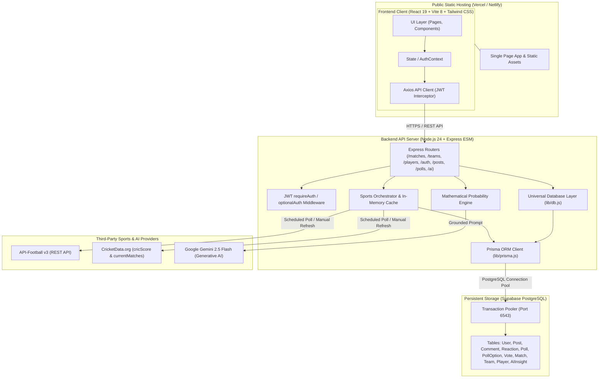
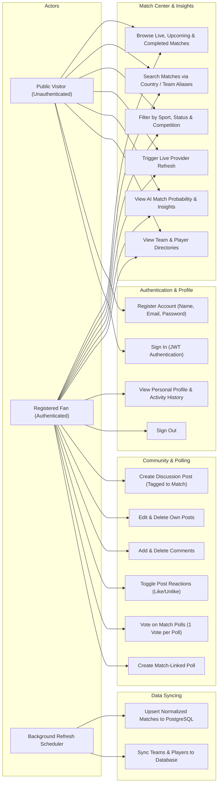
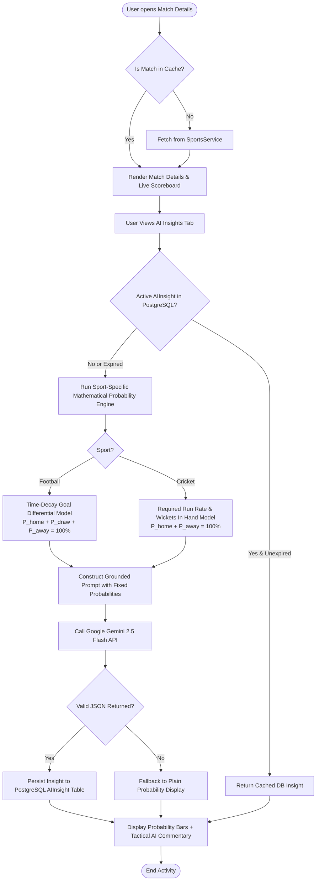
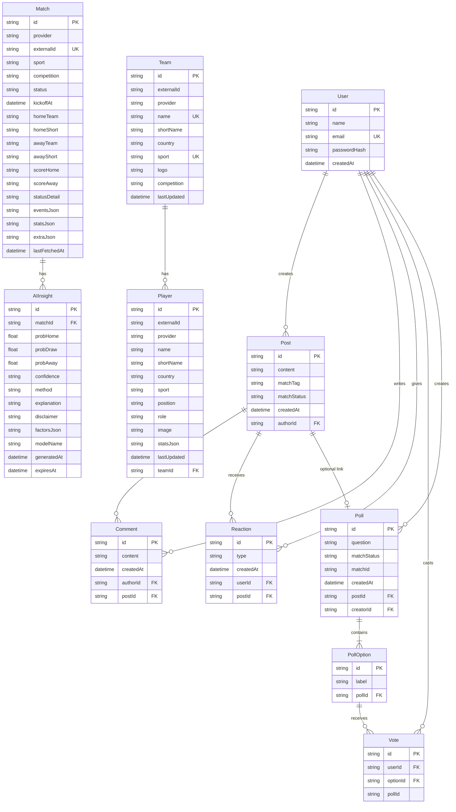

# MatchFusion — Architecture, Use Case, Activity & ER Diagrams
*SDP-1 Final Project Report Support*

---

## 1. System Architecture Diagram

---

## 2. Use Case Diagram

---

## 3. Activity Diagram (Match Refresh & AI Insight Generation)

---

## 4. Database Entity-Relationship (ER) Diagram

